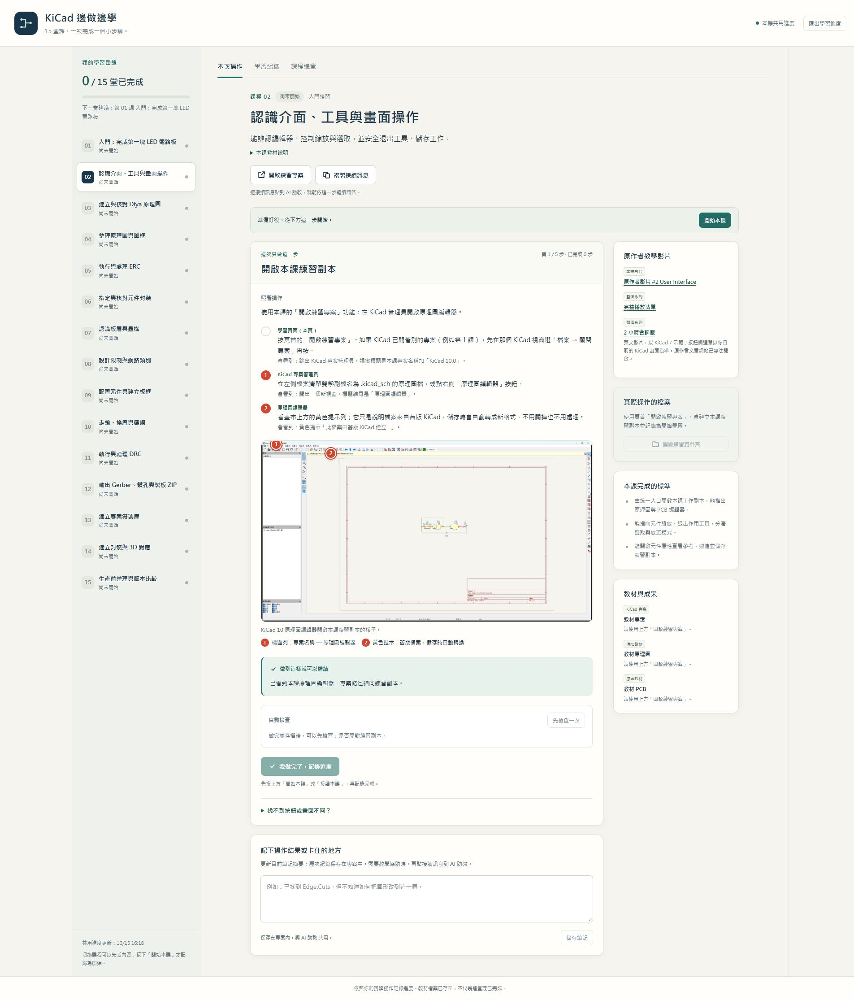

# KiCad 10 Guided Learning

**Windows only · Traditional Chinese · fork of [pcbcupid/Kicad-7-Series](https://github.com/pcbcupid/Kicad-7-Series)**

[繁體中文](README.md) · [v0.1.0](https://github.com/kongbai0123/Kicad-7-Series/releases/tag/v0.1.0)

A local learning dashboard for 15 KiCad lessons split into 36 sections and 104 small steps, plus a chapter 00 hotkey reference and an optional exercise per lesson. Each section is one page: steps on the left, real KiCad screenshots with numbered marks on the right. Any section can be opened directly, and steps can be confirmed in any order. The upstream course uses KiCad 7; the guides were prepared with KiCad 10.0.7 in Traditional Chinese.



## Requirements and launch

- Windows, Python 3.10 or newer, and KiCad.
- No Python packages, cloud account, or API key are required for the local dashboard.
- Node.js is optional and used for development checks only.

```powershell
git clone https://github.com/kongbai0123/Kicad-7-Series.git
cd Kicad-7-Series
.\Start-Learning.cmd
```

The launcher opens the local dashboard, normally at `http://127.0.0.1:8765/`. Use `Stop-Learning.cmd` to stop it. The service listens on loopback only.

## Learning and personal data

1. Select a lesson and open its practice project. Lesson 2 is optional warm-up. Lessons 3–15 continue the same project under `learning/workspaces/diya/`, starting with a blank schematic. Experiments are separate copies.
2. Follow each step and its visible success criteria. Some steps include optional observation questions or file checks.
3. Confirm a step only after performing it. To ask for help, copy the continuation message into an AI assistant that can access this repository and follow `AGENTS.md`.

The dashboard is not an embedded AI chat and does not require a particular assistant product.

**Repeat a lesson:** close the project in KiCad, then use *Restart this lesson* on the lesson page (or *Restart all lessons* on the overview). The shared Diya project returns to that lesson's starting snapshot and later lessons already begun are reset; displaced work is archived. Author rescue starts retain their source and do not count as independent creation.

On first launch, missing `learning/progress.json` is generated from the blank template: **lesson 1 selected, every lesson not started**. Existing progress is preserved. Personal progress, journals, evidence, runtime files and workspaces are ignored by Git. Back them up separately.

Original course directories retain their upstream paths, including names containing spaces. Completed LED-board examples are separate under [docs/examples](docs/examples/README.md) and never count as your progress. Before upgrading an older checkout, back up any previously tracked personal progress and designs. This release does not rewrite earlier Git history.

## Development

```powershell
python -m unittest discover -s learning -p "test_*.py" -v
node --check learning/web/sections.js
node --check learning/web/app.js
python learning/validate_repository.py
```

Windows CI runs on Python 3.10 and 3.13. See [CONTRIBUTING.md](CONTRIBUTING.md), the [changelog](CHANGELOG.md), and the [curriculum verification record](docs/CURRICULUM_CONTINUITY.md) (Traditional Chinese).

## Known limitations

- [Required checks when tools are unavailable](https://github.com/kongbai0123/Kicad-7-Series/issues/1)
- Manufacturing ZIP checks validate the seven prescribed Gerber X2 layers, current export bytes, Excellon round holes and coordinate alignment. Slot holes and alternate export formats are outside this lesson's automated check; inspect in Gerber Viewer and obtain fabricator review.
- [Annotations in enlarged screenshots](https://github.com/kongbai0123/Kicad-7-Series/issues/3)

## Attribution and license

The original course and Diya project are by PCBCupid. The Traditional Chinese guides are independently organized learning instructions, not transcripts of the original videos. The [upstream README](docs/UPSTREAM_README.md) is preserved. See the original [video playlist](https://www.youtube.com/playlist?list=PLn6004q9oeqGl91KifK6xHGuqvXGb374G).

[MIT License](LICENSE), with the original copyright notice retained.
