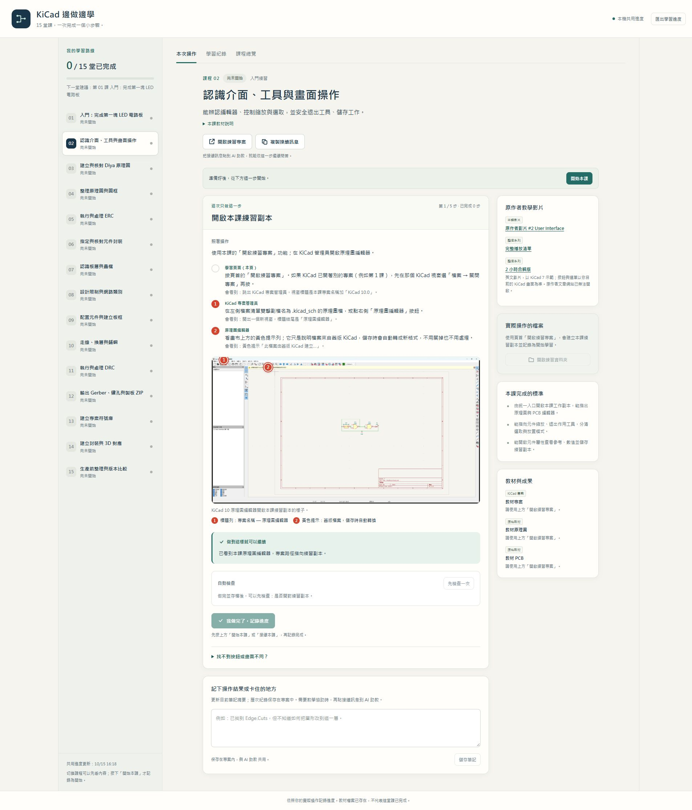

# KiCad 10 Guided Learning

**Windows only · Traditional Chinese · fork of [pcbcupid/Kicad-7-Series](https://github.com/pcbcupid/Kicad-7-Series)**

[繁體中文](README.md) · [v0.1.0](https://github.com/kongbai0123/Kicad-7-Series/releases/tag/v0.1.0)

A local learning dashboard for 15 KiCad lessons and 90 checkpoints. Follow one small task at a time, compare real KiCad screenshots and numbered annotations, and confirm your result before advancing. The upstream course uses KiCad 7; the guides were prepared with KiCad 10.0.7 in Traditional Chinese.



## Requirements and launch

- Windows, Python 3.10 or newer, and KiCad.
- No Python packages, cloud account, or API key are required for the local dashboard.
- Node.js is optional and used for development checks only.

```powershell
git clone https://github.com/kongbai0123/Kicad-7-Series.git
cd Kicad-7-Series
.\Start-Learning.cmd
```

The launcher opens the local dashboard, normally at `http://127.0.0.1:8765/`. Use `Stop-Learning.cmd` to stop it. The service listens on loopback only.

## Learning and personal data

1. Select a lesson and open its practice project. All 15 lessons use independent copies under `learning/workspaces/`.
2. Follow the current instruction and its visible success criteria. Some steps include observation questions or file checks.
3. Confirm a step only after performing it. To ask for help, copy the continuation message into an AI assistant that can access this repository and follow `AGENTS.md`.

The dashboard is not an embedded AI chat and does not require a particular assistant product.

On first launch, missing `learning/progress.json` is generated from the blank template: **lesson 1 selected, every lesson not started**. Existing progress is preserved. Personal progress, journals, evidence, runtime files and workspaces are ignored by Git. Back them up separately.

Original course directories retain their upstream paths, including names containing spaces. Completed LED-board examples are separate under [docs/examples](docs/examples/README.md) and never count as your progress. Before upgrading an older checkout, back up any previously tracked personal progress and designs. This release does not rewrite earlier Git history.

## Development

```powershell
python -m unittest discover -s learning -p "test_*.py" -v
node --check learning/web/app.js
python learning/validate_repository.py
```

Windows CI runs on Python 3.10 and 3.13. See [CONTRIBUTING.md](CONTRIBUTING.md) and the [changelog](CHANGELOG.md).

## Known limitations

- [Required checks when tools are unavailable](https://github.com/kongbai0123/Kicad-7-Series/issues/1)
- [Manufacturing ZIP validation](https://github.com/kongbai0123/Kicad-7-Series/issues/2)
- [Annotations in enlarged screenshots](https://github.com/kongbai0123/Kicad-7-Series/issues/3)

## Attribution and license

The original course and Diya project are by PCBCupid. The Traditional Chinese guides are independently organized learning instructions, not transcripts of the original videos. The [upstream README](docs/UPSTREAM_README.md) is preserved. See the original [video playlist](https://www.youtube.com/playlist?list=PLn6004q9oeqGl91KifK6xHGuqvXGb374G).

[MIT License](LICENSE), with the original copyright notice retained.
