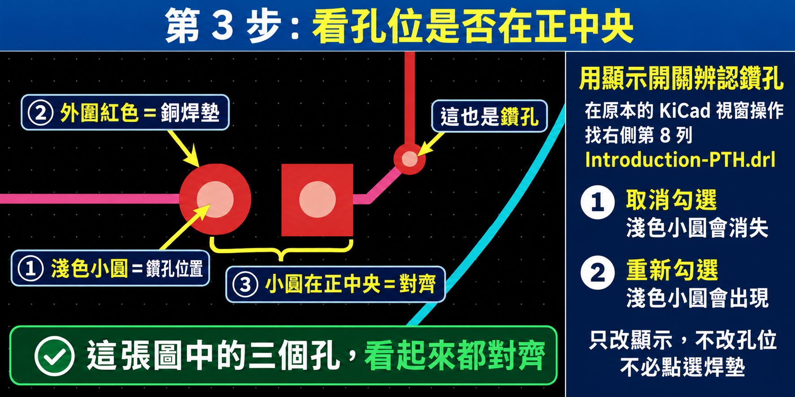

# KiCad 邊做邊學

以繁體中文、逐步操作與實際畫面，學習從原理圖到 PCB 製板輸出的完整流程。本 fork 在 [pcbcupid/Kicad-7-Series](https://github.com/pcbcupid/Kicad-7-Series) 的教材上，加入 **15 課統一入口、90 個操作檢查點、截圖圖解、練習副本與共用進度**。

原教材使用 **KiCad 7**；本學習系統以 **Windows 與 KiCad 10.0.7 繁體中文介面**實作。2026-10-15 版本的變更見 [更新紀錄](CHANGELOG.md)。



## 快速開始

需要 Windows、Python **3.10 以上**及 KiCad。學習入口只使用 Python 標準函式庫，不需安裝 Python 套件。自動 ERC、DRC 與封裝檢查會使用 KiCad 隨附的 `kicad-cli`。

```powershell
git clone https://github.com/kongbai0123/Kicad-7-Series.git
cd Kicad-7-Series
.\Start-Learning.cmd
```

也可以在檔案總管連按兩下根目錄的 **`Start-Learning.cmd`**。程式會啟動本機服務並開啟瀏覽器，預設網址為 `http://127.0.0.1:8765/`；若連接埠被占用，會尋找下一個可用位置。服務只監聽本機。

1. 選擇課程，按 **開啟練習專案**。第 2 至 15 課會建立自己的副本。
2. 每次只做目前這一步，對照操作說明、編號圖與成功判準。
3. 有小問題時先作答；有自動檢查時可按 **先檢查一次**。
4. 實際完成後按 **我做完了，記錄進度**，再進到下一步。
5. 卡住時，按 **複製接續訊息**貼入可存取本專案的 Codex 對話，附上當前畫面，接著逐步問答。

問答引導在對話中進行，學習頁負責呈現課程及保存進度。單獨使用頁面不需要 OpenAI API 金鑰。完整操作方法見 [學習入口說明](learning/README.md)。停止本機服務可執行 **`Stop-Learning.cmd`**。

## 15 課學習路線

| 課程 | 主題 | 原教材 |
| --- | --- | --- |
| 01 | 入門與第一塊 LED 電路板 | [1_Introduction](1_Introduction/) |
| 02 | 介面、工具與畫面操作 | [2_User Interface](2_User%20Interface/) |
| 03 | 建立與核對 Diya 原理圖 | [3_Schematics](3_Schematics/) |
| 04 | 整理原理圖與圖框 | [4_Prettify_Schematics](4_Prettify_Schematics/) |
| 05 | 執行與處理 ERC | [5_Perform_ERC](5_Perform_ERC/) |
| 06 | 指定與核對元件封裝 | [6_Assign_Footprint](6_Assign_Footprint/) |
| 07 | 板層與疊構 | [7_PCB_STACKUP](7_PCB_STACKUP/) |
| 08 | 設計限制與網路類別 | [8_Constraints_And_Net_Classes](8_Constraints_And_Net_Classes/) |
| 09 | 配置元件與建立板框 | [9_PCB_Layout](9_PCB_Layout/) |
| 10 | 走線、換層與鋪銅 | [10_PCB_Routing](10_PCB_Routing/) |
| 11 | 執行與處理 DRC | [11_PCB_DRC](11_PCB_DRC/) |
| 12 | Gerber、鑽孔與製板 ZIP | [12_KiCad_Gerber_Generation](12_KiCad_Gerber_Generation/) |
| 13 | 專案符號庫 | [13_Create_Custom_Library](13_Create_Custom_Library/) |
| 14 | 封裝與 3D 對應 | [14_Create_Custom_Library_part-2](14_Create_Custom_Library_part-2/) |
| 15 | 生產前整理與版本比較 | [15_PCB_Optimization](15_PCB_Optimization/) |

原系列的共同專案是 ATtiny85 感光、感風的 Reactive / Digital Diya 電子燈。第 1 課另保留本次完成的 3V 電池、1k 電阻及 LED 圓形電路板練習。各章是不同階段的範例快照，其中第 8 課使用獨立規則示範板，請依課程說明使用各自副本。

## 引導與進度

- **一次一小步**：說明在哪個視窗、做什麼，以及成功後會看到什麼。
- **實際畫面圖解**：課程步驟附 KiCad 10 截圖、位置編號與對應文字。
- **觀察與檢查**：以小問題協助辨認畫面，並從練習檔案檢查可驗證的結果。
- **共用進度**：網頁與教師命令列共用一份 JSON，以鎖定和 revision 檢查避免互相覆寫。
- **練習副本**：第 2 至 15 課使用 `learning/workspaces/`，各課獨立操作。
- **接續教學**：學習紀錄與 [AGENTS.md](AGENTS.md) 保存引導方式，讓後續對話依最新進度接續。

本 fork 包含本次學習的進度快照：第 1 課完成至製板 ZIP，第 2 課已建立副本並停在第一步。這是既有學習紀錄，不代表下載者已完成這些課程。最新狀態以本機 `learning/progress.json` 為準。

## 第 1 課實作成果

- [問答過程、卡關原因及解法](learning/journal/2026-10-15-lesson-01.md)
- [圓形電路板 3D 畫面](learning/assets/lesson-01-round-board-3d.png)
- [Gerber 與鑽孔輸出](1_Introduction/gerber/)
- [Introduction-Gerber.zip](1_Introduction/gerber/Introduction-Gerber.zip)：7 個 Gerber、2 個鑽孔檔及 1 個 job 資訊檔，共 10 個檔案。

此成果已完成設計與輸出檢查；尚未記錄實際製板、焊接及點燈測試。

## 專案結構

```text
Kicad-7-Series/
├─ Start-Learning.cmd        本機學習入口
├─ Stop-Learning.cmd         停止本機服務
├─ AGENTS.md                 持久教學規範
├─ learning/
│  ├─ catalog.json           15 課與操作步驟
│  ├─ progress.json          共用進度
│  ├─ web/                   學習頁面
│  ├─ checks.py              自動檢查
│  ├─ manage.py              教師進度工具
│  ├─ assets/                截圖與圖解
│  ├─ journal/               學習紀錄
│  └─ workspaces/            本機練習副本，不納入 Git
├─ 1_Introduction/           第 1 課練習與製板輸出
├─ 2_User Interface/ …       其他原教材課程
└─ docs/UPSTREAM_README.md   原作者 README
```

執行中的服務資訊、日誌、練習副本及 KiCad 本機狀態不納入本次提交。請另外備份自己的練習成果。

## 檢查與維護

在根目錄執行：

```powershell
python -m unittest discover -s learning -p "test_*.py" -v
```

若有安裝 Node.js，也可以檢查前端 JavaScript 語法：

```powershell
node --check learning/web/app.js
```

測試使用隔離資料，不會替學員完成課程。教師讀取進度使用 `python learning/manage.py status`；進度寫入方式見 [AGENTS.md](AGENTS.md)。

### 目前自動檢查的限制

這是教學輔助系統，以下三點仍待改善，請搭配實際畫面及 KiCad 檢查結果判斷：

1. 找不到檢查工具或工具執行失敗時，必要檢查的「無法判斷」可能仍使整體通過。
2. ZIP 檢查目前核對副檔名與 CRC，尚未完整核對必要製板圖層及檔案內容。
3. 圖片編號目前疊在課程頁上，直接開啟原圖放大時不會保留編號。

## 原教材與授權

原教材由 **PCBCupid** 製作；本 fork 的逐步說明依實際操作整理，並非原影片逐字稿。

- [原作者儲存庫](https://github.com/pcbcupid/Kicad-7-Series)
- [原作者 README 完整內容](docs/UPSTREAM_README.md)
- [KiCad 教學播放清單](https://www.youtube.com/playlist?list=PLn6004q9oeqGl91KifK6xHGuqvXGb374G)
- [教學合輯](https://www.youtube.com/watch?v=KgmsvopC9Qk)
- [Reactive Diya 專案](https://github.com/Neutrino-1/SideQuest/tree/main/Reactive%20Diya)

沿用 [MIT License](LICENSE)，保留原作者著作權與授權條款。


