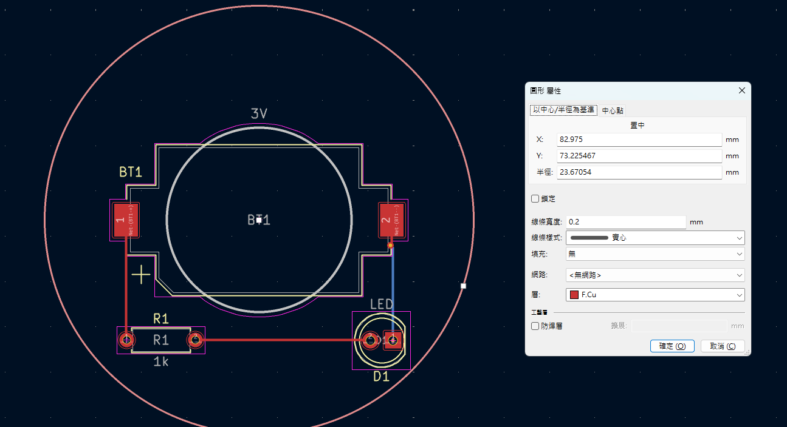
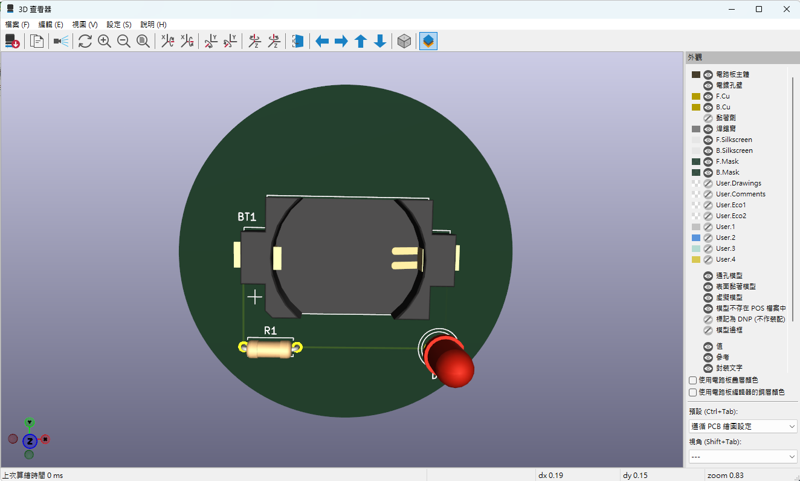
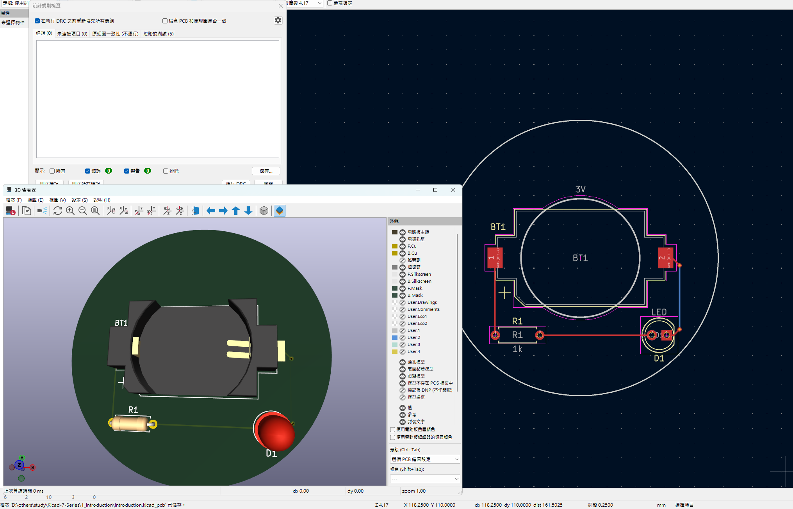
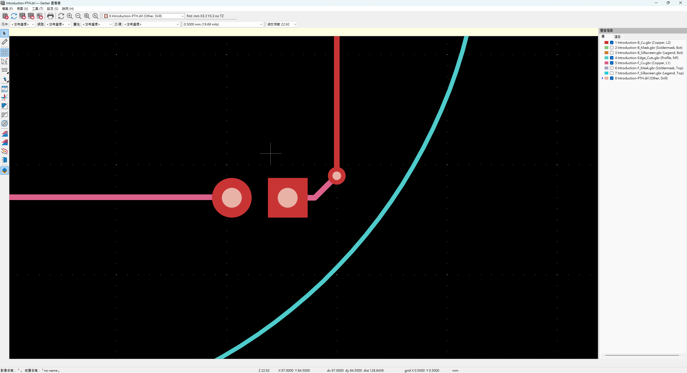

# 第 1 課 LED 圓形電路板學習紀錄

日期為 2026 年 10 月 15 日，使用 Windows 與 KiCad 10.0.7，教材為 Kicad 7 Series。學員以「做一小步、回報結果、貼圖排除問題、再往下」的方式，完成電池、電阻及 LED 的電路設計，直到 Gerber 和鑽孔檔打包。這是第 1 課的完整練習紀錄，不代表其他 14 課已完成。

## 設計與成果

專案位於 `D:\others\study\Kicad-7-Series\1_Introduction`。

| 項目 | 本次結果 |
|---|---|
| 原理圖 | BT1 標示 3V、R1 為 1k、D1 為 LED，串聯成迴路。 |
| R1 封裝 | `Resistor_THT:R_Axial_DIN0207_L6.3mm_D2.5mm_P7.62mm_Horizontal`。 |
| D1 封裝 | `LED_THT:LED_D5.0mm`。 |
| BT1 封裝 | `Battery:BatteryHolder_Keystone_1060_1x2032`，表面焊接電池座。 |
| PCB | 元件佈局與佈線完成，圓形板框放在 `Edge.Cuts`。 |
| 板框 | 半徑 23.67054 mm，直徑 47.34108 mm。 |
| 檢查 | ERC、DRC 與未連接項目通過；孔位疊圖確認對齊。 |
| 製板輸出 | `1_Introduction/gerber/` 內含 7 個 Gerber、2 個鑽孔檔與 1 個 Gerber job 檔。 |
| 打包 | `Introduction-Gerber.zip`，內含 10 個檔案。 |

## 問答與排除問題

| 學員的回報或疑問 | 原因與採取的解法 | 後續教學要保留的做法 |
|---|---|---|
| 放上 1k 電阻後繼續放電池和 LED。 | 逐個元件完成，接三條線，再儲存。電阻曾把參考編號填成 `1k`，改成 `R1`；數值仍為 `1k`。 | 參考編號與元件數值分開解釋。 |
| 「沒看到上述內容」，附符號屬性截圖。 | 依當前屬性視窗辨認「封裝」欄位，逐一完成 R1、D1 與 BT1 的封裝指定。 | 不只描述功能名稱，要指出畫面內的實際欄位。 |
| PCB 編輯器是空白，「沒看到」。 | 引導從原理圖更新至 PCB，確認三個封裝已進入 PCB 畫面。 | 依所在視窗選擇動作，匯入完成以可見封裝為判準。 |
| 匯入後元件擠在一起。 | 說明這是初始匯入狀態，再移動元件並旋轉 LED，使其腳位便於連接。 | 先辨認目前狀態，再教一個調整動作。 |
| 找不到板框工具，或「畫不出板」。 | 根據右側圖層清單與工具列截圖，辨認 `Edge.Cuts` 與繪圖工具；以 3D 視圖確認板形。 | 畫框完成與 3D 板體顯示分成可檢查的步驟。 |
| 改成圓形後，3D 仍是方板並有板框警告。 | 大圓當時畫在 `F.Cu`，只是銅層圖形；進入該圓的屬性，把圖層改為 `Edge.Cuts`。最後確認有效的圓形板框與 3D 圓板。 | 板框由圖層和封閉輪廓決定，不能只憑畫面看起來像圓形。 |
| 執行 DRC 後貼來 3D 視窗。 | 請學員回到 DRC 結果視窗，再辨認錯誤、警告及未連接項目計數。 | 3D 外觀不是電氣規則檢查結果，要看對應視窗。 |
| 開啟繪製視窗，問該勾選哪些圖層。 | 選擇雙面銅、雙面防焊、雙面絲印與 `Edge.Cuts` 共七層，輸出至 `gerber/`；不輸出鋼網用的 Paste 層。 | 每一個選項都對應目前目的，避免一次介紹所有製造設定。 |
| 不確定鑽孔輸出設定。 | 使用 Excellon、毫米、絕對原點及十進位格式，PTH 與 NPTH 分開輸出；原點需與 Gerber 一致。 | 先固定一致設定，再生成檔案並核對實際輸出位置。 |
| 「Gerber job 檔案無法作為繪製檔案載入」。 | 不再把 `.gbrjob` 當 `.gbr` 載入，改為直接載入七個 Gerber，鑽孔另用 Excellon 載入工具。 | 區分圖層檔、工作資訊檔與鑽孔檔。 |
| 以為載入鑽孔，實際仍只有七個 Gerber，曾重複成十四層。 | 先看右側檔名清單；確認新增 `Introduction-PTH.drl` 才算成功。已驗證鑽孔工具是印表機左邊的按鈕。 | 用檔名清單判斷載入結果，避免反覆載入同一批七層。 |
| 「我還是不清楚要做甚麼」，要求標示圖。 | 在當前截圖標出 Excellon 按鈕、檔名輸入位置、圖層勾選與應檢查的六個孔。 | 連續困惑時，把引導縮成一個位置與一個動作，使用真實截圖標示。 |
| 「好像沒有，但我不確定要如何用 3」。 | 放大圖中其實已出現桃色鑽孔圓。用取消及重勾第八列 `Introduction-PTH.drl`，觀察小圓消失再出現；比較其與銅墊的中心。 | 解釋顏色的意義，說清楚這一步是觀察，無須移動孔位。 |
| 「看懂了，孔位都有對齊」。 | 學員完成目視確認，再按檔案總管步驟將輸出壓縮成 ZIP。 | 完成視覺檢查後再進入交付檔案整理。 |
| 「已經打包成 Introduction-Gerber.zip，確認裡面有 10 個檔案」。 | 學員開啟 ZIP 檢查內容；後續工具亦檢查實際 ZIP，共十個項目且完整性檢查通過。 | 口頭確認與工具驗證分開保存，兩者都成立時再各自記錄。 |

## 關鍵畫面

圓形原先在 `F.Cu`，需要改為板框圖層：



修正後，3D 顯示圓形板：



DRC 結果視窗顯示錯誤與警告為零：



鑽孔疊在銅焊墊中央；桃色小圓代表鑽孔位置：



供複習的操作標示圖：

- [載入鑽孔與調整圖層的操作圖](../assets/gerbview-drill-guide.png)
- [辨認鑽孔與銅墊的操作圖](../assets/gerbview-alignment-guide.png)

## 檢查結果與證據

| 檢查項目 | 結果與證據層級 |
|---|---|
| ERC | 學員確認重新執行後為 0 錯誤、0 警告。 |
| PCB DRC | 截圖可見 0 錯誤、0 警告、0 未連接；工具另以 CLI 檢查儲存檔，含原理圖一致性檢查，亦通過。 |
| 圓形板框 | 截圖可見 3D 圓板；檔案檢查確認單一有效的 `Edge.Cuts` 圓形。 |
| 鑽孔 | 檔案座標比對確認 R1 兩孔、D1 兩孔與兩個導通孔，共六孔中心一致；學員最後也確認全部對齊。 |
| 電池座 | 檔案檢查為 SMD 封裝，兩個大長方形焊墊沒有元件鑽孔屬正常。 |
| NPTH | 本設計沒有非金屬化孔，NPTH 檔僅有檔頭而無孔資料屬正常。 |
| ZIP | 學員確認 10 個檔案；工具以 Python `zipfile` 檢查實際 ZIP 為 10 個項目，`testzip()` 回傳 `None`，表示未發現壓縮檔內容損壞。 |

這些結果確認本次設計與輸出檔案的狀態；實際製板、焊接及點燈尚未在本次練習中執行。

## 製板檔案清單

```text
Introduction-B_Cu.gbr
Introduction-B_Mask.gbr
Introduction-B_Silkscreen.gbr
Introduction-Edge_Cuts.gbr
Introduction-F_Cu.gbr
Introduction-F_Mask.gbr
Introduction-F_Silkscreen.gbr
Introduction-job.gbrjob
Introduction-NPTH.drl
Introduction-PTH.drl
```

Gerber 的鑽孔與貼裝原點選項未啟用，鑽孔使用絕對原點；座標基準一致。PTH 孔徑為 R1 0.8 mm、D1 0.9 mm、導通孔 0.4 mm。不要把 `report.txt` 當成 DRC 報告；該檔是原理圖更新至 PCB 的匯入記錄。

## 最後狀態與下次第一步

本次紀錄結束時，第 1 課完成至 ZIP 打包，尚未送製；第 2 至 15 課未開始。最新狀態以 [共用進度檔](../progress.json) 為準。

下一次從第 2 課 `02-01`「開啟練習專案」開始：在統一窗口選擇第 2 課，建立 `learning/workspaces/02/` 副本，開啟其中的 KiCad 專案，請學員回報目前看到的視窗，再進行下一個小目標。
